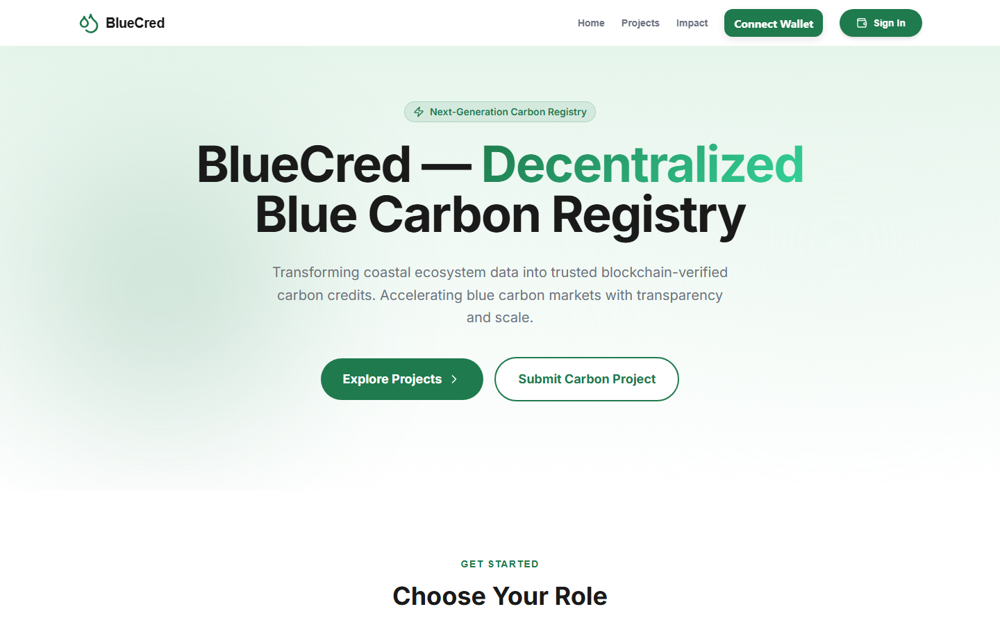
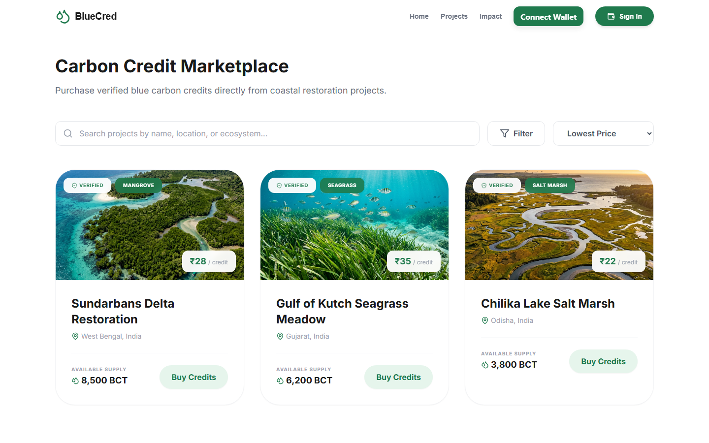
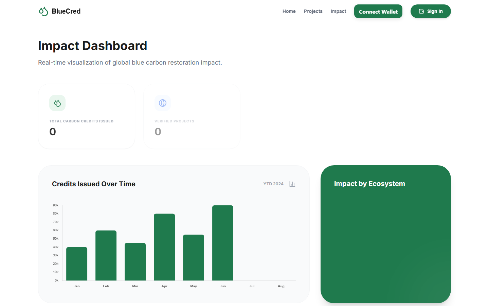
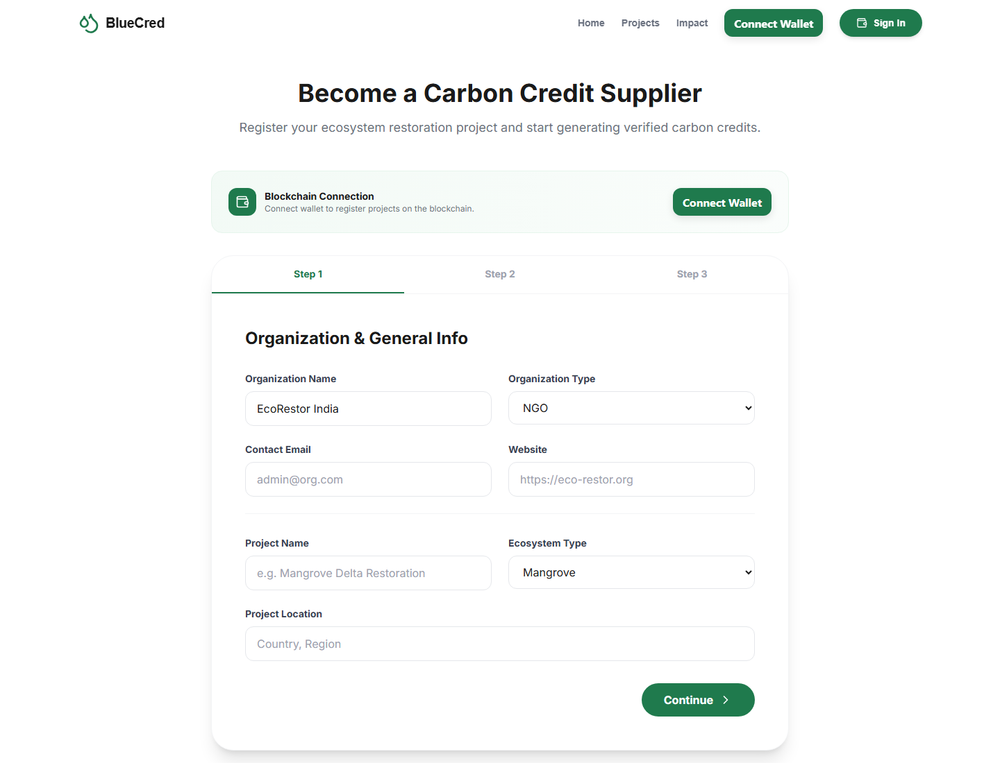
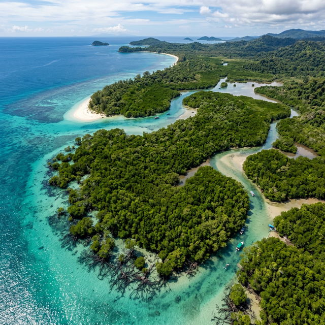
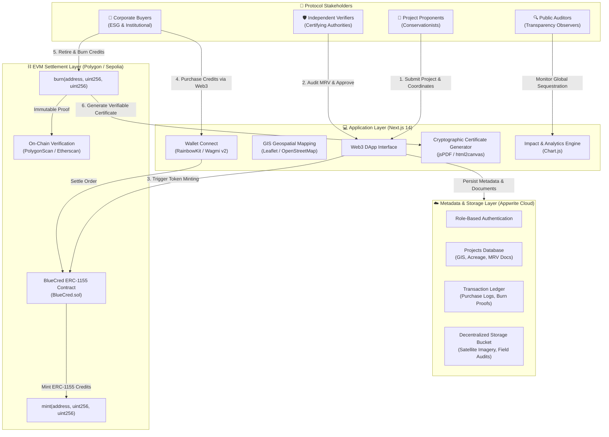
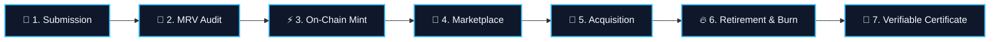

# BlueCred 🌊🌱
> **Decentralized Blue Carbon Credit Registry, Issuance & Retirement Protocol**  
> Tokenizing high-impact coastal ecosystem conservation (Mangroves, Seagrass & Salt Marshes) on EVM Blockchains.

[](https://nextjs.org/)
[](https://soliditylang.org/)
[](https://amoy.polygonscan.com)
[](https://sepolia.etherscan.io)
[](https://appwrite.io)
[](https://tailwindcss.com)
[](LICENSE)

---

## 📌 Protocol Overview

**BlueCred** is an end-to-end decentralized environmental finance protocol engineered to tokenize, verify, and trade **Blue Carbon credits**. Coastal marine ecosystems—mangroves, tidal marshes, and seagrass meadows—sequester carbon up to **10 times faster** than mature tropical forests and store it for millennia.

Traditional voluntary carbon markets face chronic challenges:
* ⚠️ **Double Counting**: The same credit sold across multiple registries.
* ⚠️ **Lack of MRV Transparency**: Opaque measurement, reporting, and verification protocols.
* ⚠️ **Broker Friction**: High intermediary margins eroding capital flowing to local coastal communities.

BlueCred resolves these structural bottlenecks by anchoring project provenance, acreage GIS data, and carbon credit tokens directly on-chain as **ERC-1155 multi-tokens**, combining verifiable decentralized settlement with real-time geospatial tracking and cloud metadata storage.

---

## 🖥️ Platform Interface & Live Application

### 🏠 Decentralized Registry Homepage
Interactive gateway for project developers, verifiers, and institutional carbon credit buyers with Web3 wallet connectivity and role selection.

<p align="center">
  
</p>

### 🛒 Liquid Carbon Credit Marketplace
Instant on-chain purchasing and trading of verified blue carbon tokens (BCT) with transparent pricing, available supply, and ecosystem filters.

<p align="center">
  
</p>

<details>
<summary><b>🔍 Expand to View Additional Modules (Impact Analytics & Supplier Onboarding)</b></summary>
<br>

### 📊 Real-Time Impact & Carbon Offset Analytics
Tracking aggregate carbon credits issued, verified conservation acreage, and historical issuance trends rendered via Chart.js.

<p align="center">
  
</p>

### 📝 Conservation Project Submission Wizard
Multi-step onboarding form for conservationists to register projects, input GIS coordinates, submit MRV documentation, and calculate potential carbon sequestration.

<p align="center">
  
</p>

</details>

---

## 🌿 Blue Carbon Asset Classes

BlueCred specializes in tokenizing the three primary coastal blue carbon ecosystems:

| Mangrove Forests | Seagrass Meadows | Tidal Salt Marshes |
| :---: | :---: | :---: |
|  |  |  |
| **High-Density Carbon Sequestration**<br>Dense root systems sequestering up to 1,000 tonnes of carbon per hectare in underwater sediment. | **Marine Biodiversity Hotspots**<br>Extensive seabed nurseries preventing ocean acidification and trapping organic carbon for centuries. | **Coastal Defense & Buffer**<br>Tidal wetlands buffering shorelines against storm surges with continuous peat sediment storage. |

---

## 🏛️ System Architecture



---

## 🔄 Carbon Credit Lifecycle Workflow



1. **Submission**: Project developers pin coastal coordinates, upload satellite evidence, and submit estimated CO2 tonnage.
2. **MRV Verification**: Environmental auditors review scientific documentation, confirm non-encroachment, and approve project metrics.
3. **On-Chain Tokenization**: The smart contract mints ERC-1155 tokens directly to the verified project repository.
4. **Marketplace Listing**: Credits are listed with transparent pricing, provenance history, and verified status.
5. **Corporate Acquisition**: Institutional buyers acquire credits directly using Web3 wallets without broker cuts.
6. **Retirement / Burn**: When offsetting emissions, credits are permanently burned on-chain to prevent secondary circulation.
7. **Certificate Generation**: A tamper-evident cryptographic retirement certificate is generated with transaction hashes for ESG audits.

---

## ⚡ Core Capabilities

### 🛒 1. Decentralized Marketplace & Project Registry
Browse and filter verified blue carbon assets by ecosystem type (Mangrove, Saltmarsh, Seagrass), acreage, country, and price. Direct wallet interaction ensures peer-to-peer settlement without middleman risk.

### 🛡️ 2. Verifier & Governance Portal
A gated administrative panel for accredited verifiers and environmental authorities to review project documentation, inspect satellite polygon boundaries, and authorize on-chain credit issuance.

### 🗺️ 3. Geospatial Mapping & GIS Tracking
Interactive Leaflet and OpenStreetMap integration allowing stakeholders to inspect coastal project coordinates, geographic boundaries, and project densities globally.

### 🔥 4. Cryptographic Retirement & PDF Certificates
Retire carbon credits on-chain with automatic burn execution. Generates an institutional-grade PDF offset certificate featuring:
- Unique Verification Token & Certificate ID
- On-chain transaction hash link to block explorer
- Timestamped retirement declaration and offset breakdown

### 📊 5. Corporate Portfolio & Global Impact Analytics
Comprehensive buyer dashboards tracking cumulative holdings, active credits, historical retirements, and ecosystem contribution metrics rendered via Chart.js.

---

## ⛓️ Smart Contract Specifications

The core protocol smart contract (`BlueCred.sol`) is built using **OpenZeppelin ERC-1155**:

| Attribute | Specification |
| :--- | :--- |
| **Standard** | ERC-1155 Multi-Token Standard |
| **Compiler** | Solidity `0.8.28` |
| **Network Deployments** | Polygon Amoy Testnet & Ethereum Sepolia |
| **Primary Functions** | `mint(to, id, amount, data)` · `burn(from, id, amount)` · `uri(id)` |
| **Contract Artifact** | `contracts/BlueCred.sol` |

### Verified Deployments

| Network | Contract Address | Block Explorer |
| :--- | :--- | :--- |
| **Polygon Amoy** | `0x920149b1e18f8d524ea443802e08837a955595c0` | [View on PolygonScan](https://amoy.polygonscan.com/tx/0xfce01b69391f233e8ab6180ec483bf5b40fdc07f5cbc3724b72a832ef21c39fe) |
| **Ethereum Sepolia** | `0x8599207114b98e239136aa6174e245409b77c5fd` | [View on Etherscan](https://sepolia.etherscan.io/address/0x8599207114b98e239136aa6174e245409b77c5fd) |

---

## 📁 Repository Structure

```
.
├── assets/                     # Protocol imagery, diagrams & screenshots
│   ├── ecosystems/             # High-resolution coastal habitat media
│   └── screenshots/            # Live application interface captures
├── contracts/                  # Solidity smart contracts
│   └── BlueCred.sol            # Core ERC-1155 token contract
├── docs/                       # Engineering & architecture specifications
│   ├── backend-setup.md        # Hardhat & Appwrite configuration
│   ├── frontend-setup.md       # Client application build guide
│   └── local-setup.md          # End-to-end integration manual
├── frontend/                   # Next.js 14 web client & dApp
│   ├── src/app/                # App Router pages & API routes
│   │   ├── admin/              # Verifier & administrative portal
│   │   ├── certificate/        # Certificate viewer & PDF export
│   │   ├── company/            # Corporate portfolio & purchases
│   │   ├── impact/             # Global impact & statistics
│   │   ├── marketplace/        # Liquid carbon credit exchange
│   │   ├── projects/           # Project registry & detail views
│   │   └── submit/             # Project onboarding & GIS wizard
│   ├── src/lib/                # Web3, Wagmi, Viem & Appwrite clients
│   └── src/scripts/            # Database initialization scripts
├── scripts/                    # Deployment & migration scripts
│   └── deploy.js               # Contract deployment automation
└── hardhat.config.ts           # Hardhat Viem configuration
```

---

## ⚙️ Installation & Development Setup

### 1. Prerequisites
- **Node.js**: v18.x or v20.x LTS
- **npm** or **pnpm**
- **MetaMask** or compatible Web3 wallet configured for Sepolia or Polygon Amoy

### 2. Clone the Repository
```bash
git clone https://github.com/Trunal2005/Blue-Cred.git
cd Blue-Cred
```

### 3. Install Dependencies
```bash
# Install root (smart contract & tooling) dependencies
npm install

# Install frontend dependencies
cd frontend
npm install
cd ..
```

### 4. Configure Environment Variables

**Root directory (`.env`):**
```bash
cp .env.example .env
```
```env
PRIVATE_KEY=your_deployer_wallet_private_key
SEPOLIA_RPC_URL=https://eth-sepolia.g.alchemy.com/v2/your_key
POLYGON_AMOY_RPC_URL=https://rpc-amoy.polygon.technology/
```

**Frontend directory (`frontend/.env.local`):**
```bash
cd frontend
cp .env.example .env.local
```
```env
NEXT_PUBLIC_APPWRITE_ENDPOINT=https://sgp.cloud.appwrite.io/v1
NEXT_PUBLIC_APPWRITE_PROJECT_ID=your_project_id
NEXT_PUBLIC_APPWRITE_API_KEY=your_admin_api_key
NEXT_PUBLIC_APPWRITE_DATABASE_ID=bluecred-db
NEXT_PUBLIC_APPWRITE_PROJECTS_COLLECTION_ID=projects
NEXT_PUBLIC_APPWRITE_TRANSACTIONS_COLLECTION_ID=transactions
NEXT_PUBLIC_APPWRITE_BUCKET_ID=project-images
NEXT_PUBLIC_SEPOLIA_RPC_URL=https://eth-sepolia.g.alchemy.com/v2/your_key
NEXT_PUBLIC_WALLETCONNECT_PROJECT_ID=your_walletconnect_id
```

### 5. Smart Contract Compilation & Deployment
```bash
# Compile contracts
npx hardhat compile

# Deploy to target network
npx hardhat run scripts/deploy.js --network sepolia
```

### 6. Initialize Appwrite Database
Provision collections, attributes, and file storage buckets automatically:
```bash
cd frontend
node src/scripts/init-appwrite.js
```

### 7. Run the Application
```bash
cd frontend

# Development server
npm run dev

# Production build & run
npm run build
npm run start
```

---

## 🛡️ Security & Best Practices

- **Zero Secret Commits**: Private keys and sensitive API tokens are decoupled via `.env` and strictly guarded by `.gitignore`.
- **Decentralized Verification**: No single entity can unilaterally mint or retire credits without on-chain cryptographic signatures.
- **Audit Provenance**: Every credit minted traces back to verified geographic coordinates and timestamped MRV audits.

---

## 📄 License

This project is licensed under the **MIT License**. See the [LICENSE](LICENSE) file for details.


## Local CNN pipeline and validation (6 November 2026)

The optional local segmentation pipeline is implemented and software-tested, but genuine mangrove training is blocked by access to suitable paired imagery. No trained mangrove checkpoint or scientific accuracy is claimed. Marketplace listings are demonstration data and cannot create purchase records. Blockchain writes default to disabled; administrator controls require a server-controlled account label. Existing remote permissions and dependency advisories still need remediation before production use.

See [final validation](docs/BLUECRED_FINAL_VALIDATION.md), [technical audit](docs/BLUECRED_TECHNICAL_AUDIT.md), [performance report](docs/BLUECRED_PERFORMANCE_REPORT.md), [training guide](docs/ml/TRAINING_GUIDE.md), [integration guide](docs/ml/INTEGRATION_GUIDE.md), and [zero-cost report](docs/BLUECRED_COST_REPORT.md). These verified reports qualify earlier architectural and security claims in this README. No production deployment or GitHub push was performed.
